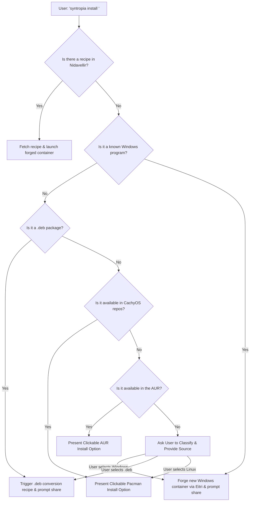
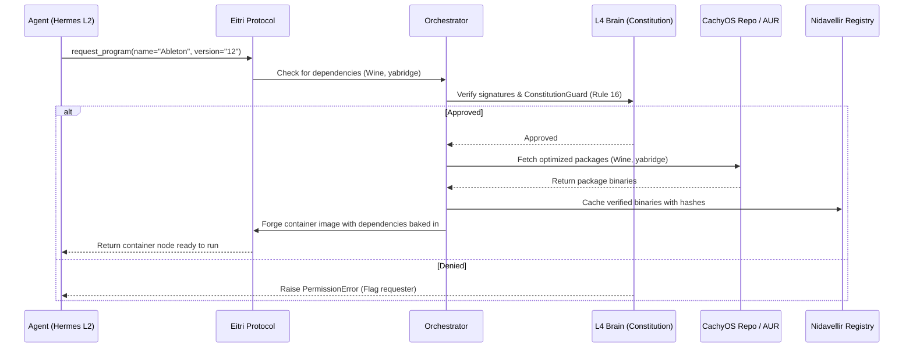

# 🧬 Eitri Protocol: Dependency Forging & Clickable Terminal Interface

> **"One user installs. The swarm remembers. Everyone benefits."**
>
> **"Share what's worth sharing. Skip what isn't."**

This plan details the design and implementation roadmap for:
1. **Nidavellir Recipe Registry**: Sandboxed Windows compatibility and native package integration.
2. **Dependency Forging Engine**: Bypassing spontaneous `yay -S` commands to dynamically forge container images with dependencies pre-baked.
3. **Program Classification Engine**: A smart decision tree sorting requests into Native, Windows/Wine, or Custom categories.
4. **Clickable Terminal Commands (OSC 8)**: An interactive terminal interface utilizing URL hyperlinking, with native Lua handler configurations optimized for **WezTerm**.

---

## 🏗️ Architecture & Flow

### 1. Program Installation Decision Flow
When a user runs `syntropia install <program>`, the classification engine follows a structured hierarchy to decide how to obtain the program safely, choosing whether to present clickable native install commands or forge container recipes.



---

### 2. Dependency Forging Sequence Diagram
Instead of installing packages directly onto the host, Syntropia compiles and builds them outside the sandbox, forging a new immutable container with all dependencies pre-baked.



---

## 📜 Nidavellir Recipe Schema (`recipe.toml`)

A recipe specifies the precise instructions, dependencies, and self-healing handlers required to forge a program container.

```toml
# recipe/ableton-live-12.toml
name = "Ableton Live 12"
version = "12.0.5"
type = "windows_app"

[dependencies]
wine = { version = "9.0", source = "cachyos", required = true }
yabridge = { version = "5.1", source = "aur", required = true }
pipewire = { version = "1.2", source = "cachyos", required = true }
pipeasio = { version = "0.2.1", source = "aur", required = false }

[optimizations]
audio = "low-latency"
scheduler = "realtime"
cgroup_nice = -15

[sandbox]
allow_network = false
allow_filesystem = [
    "~/Music",
    "~/Downloads",
    "~/.vst3"
]

[build_steps]
steps = [
    "initialize_wine_prefix --path /var/lib/syntropia/prefixes/ableton",
    "configure_yabridge --sync",
    "tune_pipewire_latency --target-ms 1"
]

[test_workload]
verify_command = "wine --version"
expected_output = "wine-9.0"
on_failure = "syntropia-healer self-heal --recipe ableton-live-12"
```

---

## 🖥️ WezTerm Clickable Terminal Commands (OSC 8)

Modern terminals support clickable text via the **OSC 8** protocol. We can print links utilizing the `syntropia://` custom scheme and intercept clicks directly in WezTerm's Lua configuration.

### 1. Terminal Escape Sequence Output
Syntropia prints clickable buttons directly in WezTerm:
```bash
# Clickable Pacman Install Option
echo -e "\e]8;;syntropia://run?cmd=sudo+pacman+-S+vlc\e\\📦 Click here to install VLC natively\e]8;;\e\\"

# Clickable Manual Instructions Link
echo -e "\e]8;;https://syntropia.local/docs/vlc\e\\📖 Click here for manual setup guide\e]8;;\e\\"
```

---

### 2. WezTerm Lua Configuration (`wezterm.lua`) with Auditing
Add this configuration snippet to `~/.config/wezterm/wezterm.lua` to capture `syntropia://` custom scheme URIs, audit click actions to the Bulletin Chain, and execute the requested command inside the active pane.

```lua
local wezterm = require 'wezterm'

wezterm.on("open-uri", function(window, pane, uri)
  -- Check if the clicked link belongs to Syntropia
  if uri:find("^syntropia:") == 1 then
    -- Parse query parameter, e.g. cmd=sudo+pacman+-S+vlc
    local command = uri:match("cmd=([^&]+)")
    if command then
      -- URL Decode the command (replace '+' with ' ' and handle percent encoding)
      command = command:gsub("%+", " "):gsub("%%(%x%x)", function(h)
        return string.char(tonumber(h, 16))
      end)
      
      -- AUDITING: Log click action to the Bulletin Chain for compliance
      wezterm.run_child_process({
        "/opt/syntropia/src/cli.py", "log-click",
        "--uri", uri,
        "--command", command
      })
      
      -- Send the command directly into the active pane (with carriage return)
      pane:send_text(command .. "\r")
      return false  -- Tell WezTerm we successfully handled the URL
    end
  end
  -- Let WezTerm handle standard http/https/file URIs normally
  return true
end)

return {
  -- Your normal WezTerm configs...
}
```

---

## 🎨 User Interface Scenarios

### Scenario 1: Native App (VLC) - Simple & Silent
```text
User: syntropia install vlc

Syntropia:
  🔍 Detected: VLC is a native Linux app (CachyOS repo)
  
  📦 [Click here to install with sudo pacman -S vlc]
  📖 [Click here for manual instructions]
  
  > User clicks the first link
  
  ✅ Running: sudo pacman -S vlc
  ✅ VLC installed.
  
  🎬 VLC is ready to use.
```
*Note: Since VLC is a standard native package, the "Share Recipe" prompt is silently skipped to avoid friction.*

---

### Scenario 2: Windows App (Ableton) - Shares Custom Recipe
```text
User: syntropia install ableton

Syntropia:
  🔍 Detected: Windows application (Wine/Proton compatible)
  🏗️ Forging container via Eitri Protocol...
  ✅ Ableton Live 12 ready to run.
  
  📤 Share this recipe with the swarm? (y/n)
  > y
  
  ✅ Recipe shared to Nidavellir.
```

---

### Scenario 3: Debian Package (discord.deb) - Conversion & Sharing
```text
User: syntropia install discord.deb

Syntropia:
  🔍 Detected: .deb package
  📦 Converting to Arch package format...
  ✅ Discord installed.
  
  📤 Share this recipe with the swarm? (y/n)
  > y
  
  ✅ Recipe shared to Nidavellir.
```

---

### Scenario 4: AUR Package (yay) - Security Constraint
```text
User: syntropia install yay

Syntropia:
  🔍 Detected: AUR package
  ⚠️ Warning: AUR packages are community-maintained and unvetted.
  
  📦 [Click here to install with yay -S yay --aur-trusted]
  📖 [Click here for manual instructions]
```
*Note: Installing untrusted AUR packages requires confirmation or the explicit `--aur-trusted` flag configuration.*

---

## 📜 Constitutional Rule Additions

To establish the boundaries of package management, we will append these rules to the Syntropia Constitution:

> ### Rule 16: Nidavellir Repository
> "Agents may request programs from the Nidavellir Repository via the Eitri Protocol. Programs in Nidavellir are pre-vetted and do not require L4 approval. Programs not in Nidavellir must be approved by the L4 Brain or a Human L4 before a new container image can be forged."
>
> ### Rule 17: Recipe Sharing
> "Users may request the installation of any program via the `syntropia install` command. Upon successful installation, the user shall be prompted to share the recipe with the swarm only if the program is a Windows application or a .deb package. Shared recipes become public and can be used by any other node. Additional types may be added in the future."
>
> ### Rule 18: Program Classification
> "When a user requests a program, Syntropia shall first check Nidavellir, then CachyOS repos, then AUR, then Windows compatibility databases. If the program remains unidentified, the user shall be prompted to classify it. The result shall be logged and used to improve future classifications."
>
> ### Rule 19: Terminal Interaction Protocol
> "Syntropia shall use OSC 8 hyperlinks to provide clickable commands, approval buttons, and contextual help. Click actions on commands shall be logged on the Bulletin Chain for auditing purposes. The user shall always have the option to bypass these links and use traditional terminal commands."

---

## 📅 Implementation Roadmap

* [ ] **Phase 1**: Add constitutional Rules 16, 17, 18, and 19 checks to `src/syntropia/constitution.py`.
* [ ] **Phase 2**: Define the TOML Recipe parser using `tomllib` (with comments preservation fallbacks) in `src/syntropia/recipe.py`.
* [ ] **Phase 3**: Implement the Program Classification Engine (`src/syntropia/classifier.py`), querying local pacman databases and fallback AUR indexes, using the `should_prompt_share` conditional check.
* [ ] **Phase 4**: Add OSC 8 hyperlink escape sequence utilities to format terminal outputs, and register a CLI command `log-click` to audit terminal clicks to the Bulletin Chain.
* [ ] **Phase 5**: Create the custom `syntropia install` CLI entrypoint in `src/main.py`.
* [ ] **Phase 6**: Write test suites verifying program classification logic, recipe parser validation, self-healing hooks, and dependency forging constraints.
