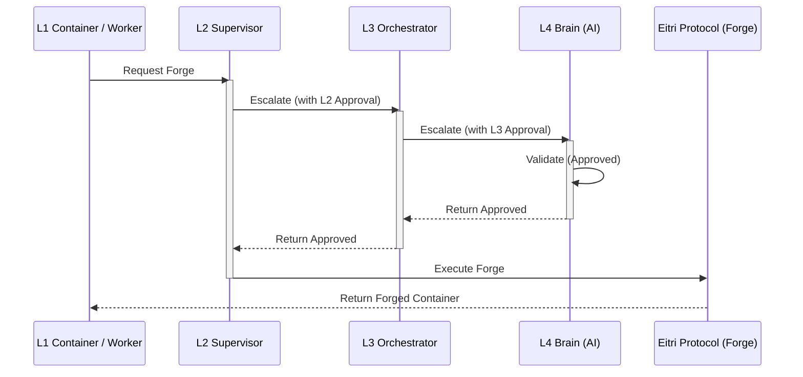
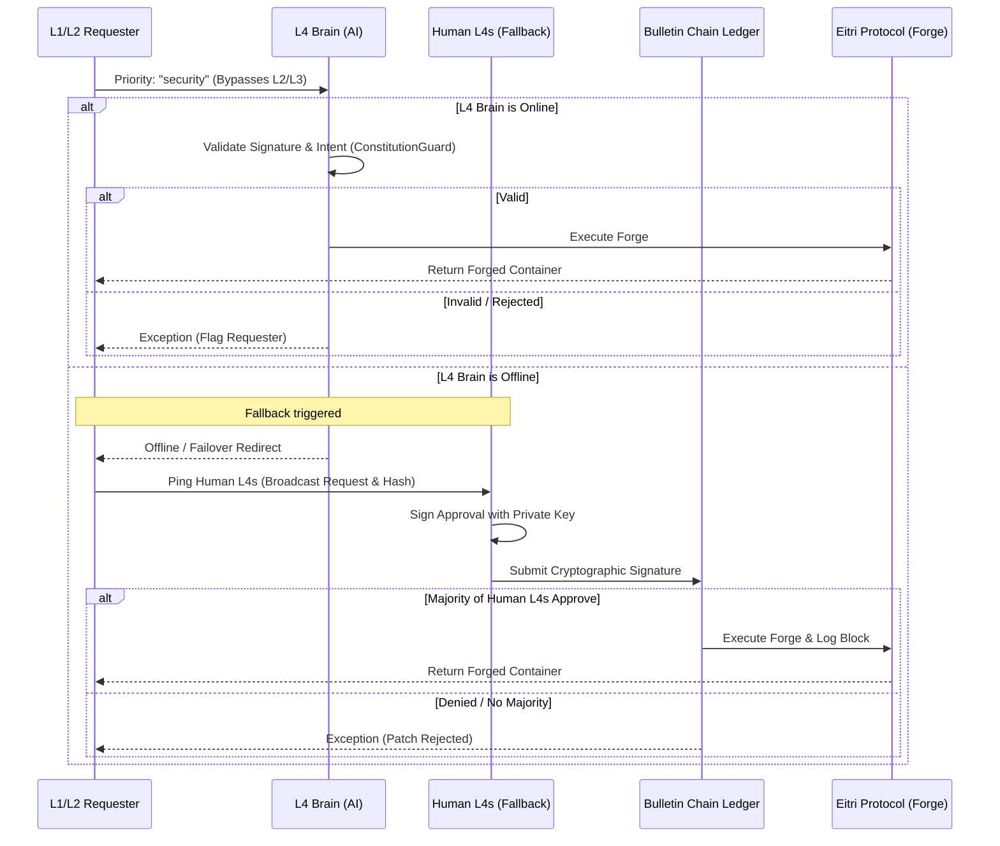
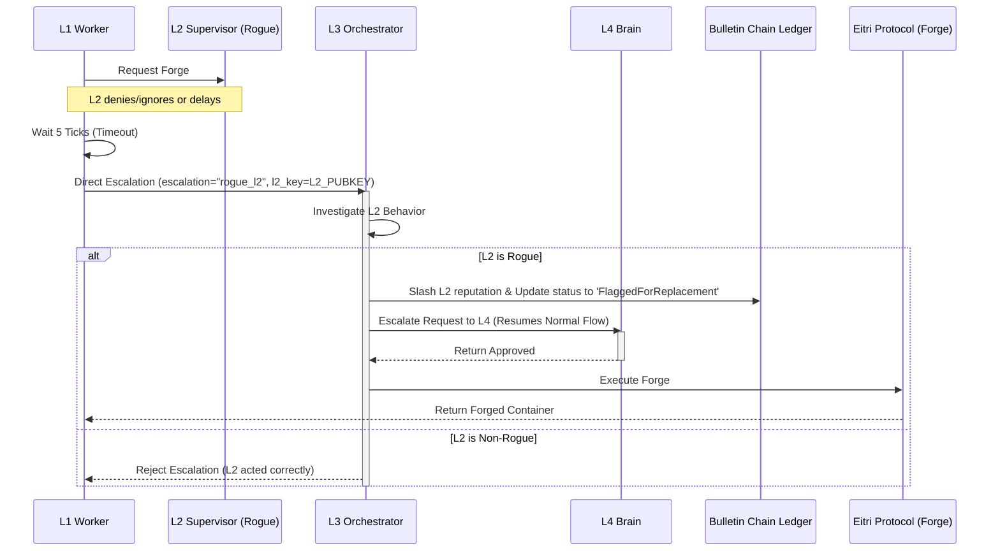

# 🧬 Eitri Protocol: Escalation, Exception Paths & Forging Plan

> **"Eitri forged the hammer that could level mountains. We forge the containers that will build a living intelligence."**

This plan details the design and implementation roadmap for upgrading the **Eitri Protocol** (`EitriProtocol` class) to support container forging, CLI commands, multi-tiered escalation hierarchy, time-sensitive security bypasses (with human fallback), and rogue L2 detection mechanisms.

---

## 🏗️ Core Forging Flow

All new containers in the Syntropia ecosystem are created via the Eitri Protocol. The forging process registers metadata, verifies limits, and logs records to the Bulletin Chain.

### 1. Command Line Interface (CLI) Forge Command
Administrators can manually trigger container creation using the `syntropia forge` CLI command:

```bash
# Forge a new container via Eitri Protocol
syntropia forge --role L1 --model hermes-0.5b --memory 512 --ttl 3600
```

#### Mock Output:
```text
🔥 Eitri Protocol: Forging new L1 Manager...
   - Blueprint: L1 | Hermes 0.5B | 512MB RAM
   - Anvil struck. Resources allocated.
   - Bellows stoked. Image pulled from Nidavellir.
   - Spark ignited. Container running.
   - Quenched. Registered with Odin (Orchestrator).
   ✅ Agent 'hermes-l1-003' is now alive!
```

---

### 2. L1 Manager Requesting L0 Workers
L1 Manager containers can dynamically request multiple L0 workers to execute subtasks. The Orchestrator intercepts these requests and performs validation checks:
1. **Resource Allocation**: Does the requesting L1 container have enough resource quota left to spawn these children?
2. **System Limits**: Does the individual container request fit within constitutional sandbox limits (e.g., memory limits)?

```python
# L1 Manager requests 1,000 L0 workers via Eitri Protocol
request = {
    "requester_id": "hermes-l1-003",
    "role": "L0",
    "count": 1000,
    "image": "syntropia/worker-script:latest",
    "resources": {"memory_mb": 10, "cpu": "0.1", "timeout": 60}
}

# Send request to the Orchestrator
response = orchestrator.request_containers(request)

if response["status"] == "approved":
    print(f"🔥 Eitri Protocol: Forged {response['count']} L0 workers.")
else:
    print(f"❌ Forge failed: {response['reason']}")
```

---

## 🏗️ Escalation & Message Flows

### 1. Normal Escalation Chain (`L1 → L2 → L3 → L4`)
In normal operations, a container request must flow through each level of the hierarchy. If approved by the higher levels, the Eitri Protocol executes and returns the forged container.



---

### 2. Exception 1: Time-Sensitive Security Patches (`L1/L2 → L4 → Human Fallback`)
For urgent security patches, the chain is bypassed. The patch is submitted directly to the **L4 Brain**. If the L4 Brain is offline, the request fails over to the registered **Human L4s**, who must provide a cryptographically signed approval.



---

### 3. Exception 2: Rogue L2 Detection & Escalation (`L1 → L3`)
If an L2 supervisor ignores or maliciously denies a valid request, the L1 worker waits for a timeout (e.g., 5 ticks) and escalates directly to the L3 Orchestrator. The L3 Orchestrator investigates and, if rogue, slashes the L2's reputation and flags it for replacement.



---

## 📜 Constitutional Rule Additions

To codify these behaviors, we will append the following rules to the Syntropia Constitution:

> ### Rule 15: Eitri Protocol
> "All new containers shall be forged via the Eitri Protocol. The blueprint must define the role, resource limits, and sandbox constraints. No container shall be born without a forge record on the Bulletin Chain."
>
> ### Rule 15.1: Normal Escalation Chain
> "All standard container forge requests must originate or traverse sequentially through the level hierarchy: L1 → L2 → L3 → L4. No lower-level container may execute forging without higher-level authorization."
>
> ### Rule 15.2: Structural and Strategic Changes
> "Any strategic or structural modifications to the container hierarchy must be validated and explicitly approved by the L4 Brain."
>
> ### Rule 15.3: Security Bypass (with L4 → Human L4 Fallback)
> "Requests tagged with priority='security' shall bypass the normal escalation chain (L2 → L3) and go directly to the L4 Brain for immediate validation. If the L4 Brain is offline, the request shall be forwarded to all registered Human L4s. A majority of Human L4s must approve before the patch is executed. All approvals must be cryptographically signed and logged on the Bulletin Chain. Invalid signatures will result in immediate requester flagging."
>
> ### Rule 15.4: Rogue L2 Escalation
> "If an L1 suspects an L2 of malicious or negligent behavior (e.g. denying or ignoring requests beyond 5 ticks), it may escalate directly to L3. L3 shall investigate and, if warranted, slash the L2's reputation and flag it for replacement."

---

## 🔧 Code Implementation Architecture

We will implement the protocol in a new file [src/syntropia/eitri.py](file:///home/r4/Desktop/Project-Syntropia/src/syntropia/eitri.py):

### 1. `EitriProtocol` Class Structure
```python
import logging
import uuid
from typing import Dict, Any, List
from syntropia.container import ContainerNode
from syntropia.blockchain import SQLiteBulletinChain
from syntropia.crypto import AgentIdentity

logger = logging.getLogger("syntropia.eitri")

class EitriProtocol:
    def __init__(self, blockchain: SQLiteBulletinChain, human_l4_keys: List[str] = None):
        self.blockchain = blockchain
        self.human_l4_keys = human_l4_keys or []
        self._l4_brain_online = True
        
        # Simulated resources allocated to L1s (L1 name/key -> dict of allocation limits)
        self.l1_allocations = {}

    def set_l4_brain_status(self, online: bool):
        self._l4_brain_online = online

    def set_l1_allocation(self, l1_name: str, memory_mb: int, cpu: float):
        """Sets simulated resource quota limits for L1 Managers."""
        self.l1_allocations[l1_name] = {"memory_mb": memory_mb, "cpu": cpu}

    def request_containers(self, request: Dict[str, Any]) -> Dict[str, Any]:
        """
        Validates container requests from L1 Managers to spawn L0 workers.
        Ensures L1 has enough resource allocation, request falls within system limits,
        and logs the birth of forged containers on the Bulletin Chain.
        """
        requester = request.get("requester_id")
        role = request.get("role")
        count = request.get("count", 1)
        resources = request.get("resources", {})
        req_memory = resources.get("memory_mb", 10)
        req_cpu = float(resources.get("cpu", "0.1"))
        
        total_req_memory = req_memory * count
        total_req_cpu = req_cpu * count

        # 1. Verify system limits per container (e.g. max memory limit of 128MB for L0)
        if role == "L0" and req_memory > 128:
            return {
                "status": "denied",
                "reason": f"System Limit Violation: L0 worker memory limit ({req_memory}MB) exceeds maximum (128MB)."
            }

        # 2. Check requester allocation
        if requester not in self.l1_allocations:
            return {
                "status": "denied",
                "reason": f"Unauthorized: Requester '{requester}' has no resource allocations."
            }

        allocation = self.l1_allocations[requester]
        if total_req_memory > allocation["memory_mb"] or total_req_cpu > allocation["cpu"]:
            return {
                "status": "denied",
                "reason": f"Resource Quota Exceeded: Requested {total_req_memory}MB RAM & {total_req_cpu} CPU, "
                          f"but allocation is {allocation['memory_mb']}MB & {allocation['cpu']} CPU."
            }

        # 3. Approve and log each forged worker container to the Bulletin Chain
        for i in range(count):
            worker_id = f"{requester}-worker-{uuid.uuid4().hex[:6]}"
            self.blockchain.store_payload({
                "event": "container_forge",
                "container_id": worker_id,
                "role": role,
                "image": request.get("image"),
                "resources": resources
            })

        return {
            "status": "approved",
            "count": count
        }

    def forge(self, request: Dict[str, Any]) -> ContainerNode:
        """
        Coordinates the Eitri Protocol forging request.
        Dispatches according to escalation logic or exceptions.
        """
        # 1. Check for exception conditions
        if request.get("priority") == "security":
            return self._forge_security(request)
        
        if request.get("escalation") == "rogue_l2":
            return self._forge_escalated(request)

        # 2. Normal escalation chain
        level = request.get("requestor_level")
        if level == "L1":
            return self._forge_with_approval(request, "L2")
        elif level == "L2":
            return self._forge_with_approval(request, "L3")
        elif level == "L3":
            return self._forge_with_approval(request, "L4")
        else:
            raise ValueError(f"Invalid requestor level: {level}")

    def _forge_with_approval(self, request: Dict[str, Any], next_approver_level: str) -> ContainerNode:
        """Recursive escalation verification."""
        logger.info(f"Escalating request to {next_approver_level}...")
        
        if not self._check_level_approval(next_approver_level, request):
            raise PermissionError(f"Request denied at level: {next_approver_level}")

        if next_approver_level == "L4":
            return self._execute_forge(request)
        
        next_level_map = {"L2": "L3", "L3": "L4"}
        return self._forge_with_approval(request, next_level_map[next_approver_level])

    def _check_level_approval(self, level: str, request: Dict[str, Any]) -> bool:
        """Helper to simulate level-based approvals."""
        approved_levels = request.get("approved_levels", [])
        return level in approved_levels or level == "L4"

    def _verify_signature(self, request: Dict[str, Any]) -> bool:
        """Verifies cryptographic signature on the request."""
        signature = request.get("signature")
        payload = request.get("payload")
        public_key = request.get("proposer_key")
        if not signature or not payload or not public_key:
            return False
        try:
            return AgentIdentity.verify(public_key, payload, bytes.fromhex(signature))
        except Exception:
            return False

    def _forge_security(self, request: Dict[str, Any]) -> ContainerNode:
        """Time-sensitive security patch. Bypasses L2/L3."""
        logger.info("Executing security bypass protocol (L1/L2 -> L4)...")
        if not self._verify_signature(request):
            self._flag_requestor(request.get("proposer_key"), "Invalid security patch signature")
            raise PermissionError("Security patch signature invalid.")

        if self._l4_brain_online:
            l4_response = self._try_l4_approval(request)
            if l4_response.get("status") == "approved":
                return self._execute_forge(request)
            else:
                raise PermissionError("Security patch rejected by L4 Brain.")

        logger.warning("L4 Brain offline. Pinging human L4s...")
        human_approval = self._ping_human_l4s(request)
        if not human_approval:
            raise PermissionError("Security patch rejected by human L4s.")

        return self._execute_forge(request)

    def _try_l4_approval(self, request: Dict[str, Any]) -> Dict[str, Any]:
        """Simulates validation check by L4 Brain."""
        from syntropia.constitution import ConstitutionGuard
        guard = ConstitutionGuard()
        approved, reason = guard.check_mutation(request)
        if approved:
            return {"status": "approved"}
        return {"status": "denied", "reason": reason}

    def _ping_human_l4s(self, request: Dict[str, Any]) -> bool:
        """Pings registered human L4s and validates majority signatures."""
        approvals = request.get("human_approvals", [])
        if not self.human_l4_keys:
            return False

        valid_approvals_count = 0
        approval_payload = request.get("payload", "")

        for app in approvals:
            pub_key = app.get("public_key")
            sig = app.get("signature")
            if pub_key in self.human_l4_keys:
                if AgentIdentity.verify(pub_key, approval_payload, bytes.fromhex(sig)):
                    valid_approvals_count += 1
                    # Log approval transaction on-chain
                    self.blockchain.store_payload({
                        "event": "human_l4_approval",
                        "request_payload": approval_payload,
                        "human_l4_key": pub_key,
                        "signature": sig
                    })

        required_majority = (len(self.human_l4_keys) // 2) + 1
        return valid_approvals_count >= required_majority

    def _forge_escalated(self, request: Dict[str, Any]) -> ContainerNode:
        """Escalated request from L1 bypassing rogue L2."""
        if not self._investigate_l2(request):
            raise PermissionError("L2 found to be non-rogue. Request denied.")
        return self._forge_with_approval(request, "L3")

    def _investigate_l2(self, request: Dict[str, Any]) -> bool:
        """Investigates L2 behavior. If rogue, slashes reputation on-chain."""
        l2_key = request.get("l2_key")
        if not l2_key:
            return False

        is_rogue = request.get("l2_is_rogue", False)
        if is_rogue:
            # Slash reputation
            self.blockchain.update_reputation(l2_key, -50.0)
            self.blockchain.update_agent_status(l2_key, "FlaggedForReplacement")
            return True
        return False

    def _flag_requestor(self, public_key: str, reason: str):
        """Flag requester on-chain for submitting invalid security patch."""
        if public_key:
            try:
                self.blockchain.update_reputation(public_key, -20.0)
                self.blockchain.update_agent_status(public_key, "FlaggedSuspicious")
            except Exception as e:
                logger.error(f"Failed to flag requestor: {e}")

    def _execute_forge(self, request: Dict[str, Any]) -> ContainerNode:
        """Executes Eitri protocol forging to create the resulting ContainerNode."""
        # Log container birth on the Bulletin Chain
        container_id = request.get("container_id", "forged_node_001")
        self.blockchain.store_payload({
            "event": "container_forge",
            "container_id": container_id,
            "role": request.get("container_role", "worker"),
            "status": "Born"
        })
        
        return ContainerNode(
            node_id=container_id,
            name=request.get("container_name", "Forged Container"),
            level=request.get("requestor_level", "L0"),
            role=request.get("container_role", "worker"),
            runtime=request.get("runtime", {})
        )

---

## 🧪 Testing Plan

We will create a comprehensive test suite in [tests/test_eitri.py](file:///home/r4/Desktop/Project-Syntropia/tests/test_eitri.py) containing:
1. **Resource & System Limit Verification**:
   - Verify that L1 Manager requests for L0 workers fail if the L1 resource allocation is exceeded.
   - Verify that individual L0 requests fail if resource limits (e.g. memory > 128MB) are violated.
   - Verify successfully approved worker container forge logging on-chain.
2. **Normal Escalation Verification**:
   - Ensure L1 request flows through L2 -> L3 -> L4.
   - Test denial at different levels (e.g. L2 denying, L3 denying).
3. **Security Patch Bypass Verification**:
   - Verify that requests with `priority="security"` bypass L2 and L3.
   - Verify cryptographic validation of the proposer signature.
   - Verify fallback to Human L4s when L4 Brain is offline.
   - Verify that a majority of signatures from registered Human L4s allows the forge.
   - Verify that invalid signatures lead to on-chain reputation slashing and status flagging of the requester.
4. **Rogue L2 Escalation Verification**:
   - Verify L1 escalating directly to L3 when L2 ignores/denies requests.
   - Verify that L3's investigation correctly slashes L2 reputation and flags it for replacement on-chain.
   - Verify that non-rogue L2 claims reject the escalation.

---

## 📅 Phases & Milestones

* [x] **Phase 1**: Add constitutional rule additions to `src/syntropia/constitution.py`.
* [x] **Phase 2**: Implement the `EitriProtocol` class inside `src/syntropia/eitri.py` and register it in `src/syntropia/__init__.py`.
* [x] **Phase 3**: Create unit tests in `tests/test_eitri.py`.
* [x] **Phase 4**: Run tests and debug implementation details.
